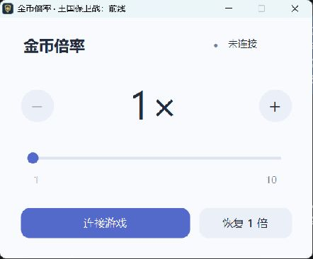

# KingdomRushFrontiersGoldTrainer

[简体中文](README.md) | English

A portable Windows gold multiplier for **Kingdom Rush Frontiers on Steam**. Connect while the game is running and adjust gold income from **1× to 10×**.



## Usage

1. Download `KingdomRushFrontiersGoldTrainer.exe` from [Releases](https://github.com/Daaaaxianer/KingdomRushFrontiersGoldTrainer/releases/latest).
2. Launch the game through Steam and enter a level.
3. Open the trainer, click **连接游戏** (Connect), then use the slider, plus/minus buttons, or arrow keys to set the multiplier.

The multiplier applies to enemy kills and early-wave rewards. Starting gold, building costs, tower refunds, gems, and lives follow the game's usual rules.

**恢复 1 倍** (Reset to 1×) keeps the connection. Disconnecting or closing the trainer restores normal future income. Gold already earned and game progress are retained. If the trainer exits unexpectedly, a heartbeat timeout restores 1× after about 2.5 seconds.

## Compatibility and files

Requires Windows x64 and .NET Framework 4.8. The game executable and `lua51.dll` must match the SHA256 hashes in [compatibility.json](compatibility.json). Game updates may require a new trainer build. Run the game and trainer with the same user privileges.

The EXE includes the bridge DLL. On first connection, it extracts the module to `%TEMP%/KRFLocalGoldTrainer` and backs up existing local saves to `%LOCALAPPDATA%/KRFLocalGoldTrainer/存档备份`.

The trainer loads its DLL into the game process and handles gold rewards through Lua. The module is cleared when the game exits.

Control interaction, UI scaling, background connection, and simulated-session tests pass. Live attachment and rewards in an actual level still need verification.

## Build

Requires Python 3.9+, the Windows .NET Framework x64 `csc.exe`, and MinGW-w64 x64 GCC.

```powershell
python scripts/build.py --test
```

Use `--gcc "path/to/gcc.exe"` if GCC is not on PATH. The EXE and `SHA256SUMS.txt` are written to `dist/`.

## License

Adapted from [KingdomRushGoldTrainer](https://github.com/Daaaaxianer/KingdomRushGoldTrainer) under the [MIT License](LICENSE).

This is an unofficial tool. Kingdom Rush and related trademarks belong to their respective owners.
