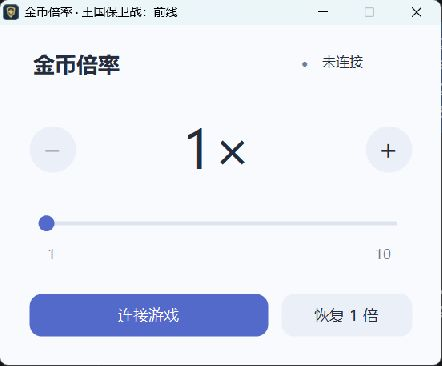

# KingdomRushFrontiersGoldTrainer

[English](README.en.md) | 简体中文

Steam《王国保卫战：前线》的 Windows 单文件金币倍率修改器。游戏运行中可随时连接，调整 **1–10 倍**金币收入。



## 使用

1. 在 [Releases](https://github.com/Daaaaxianer/KingdomRushFrontiersGoldTrainer/releases/latest) 下载 `KingdomRushFrontiersGoldTrainer.exe`。
2. 从 Steam 启动游戏并进入关卡。
3. 打开修改器，点击 **连接游戏**，用滑块或加减按钮调整倍率，也可以使用方向键。

倍率作用于击杀金币和提前开波奖励。初始金币、建塔费用、卖塔返还、宝石和生命按游戏原有规则计算。

**恢复 1 倍**会保留连接。**断开连接**或正常关闭修改器后，后续收入恢复正常，已获得的金币和游戏进度会保留。修改器异常退出时，约 2.5 秒后自动恢复 1 倍。

## 兼容与文件位置

支持 Windows x64，需要 .NET Framework 4.8。游戏程序和 `lua51.dll` 须与 [compatibility.json](compatibility.json) 中的 SHA256 匹配；游戏更新后可能需要重新适配。请让游戏与修改器以相同用户权限运行。

EXE 内含连接模块，移动时只需携带这一个文件。首次连接会释放模块到 `%TEMP%/KRFLocalGoldTrainer`，并将已有本地存档备份到 `%LOCALAPPDATA%/KRFLocalGoldTrainer/存档备份`。

修改器会在游戏进程中加载 DLL，通过 Lua 处理金币奖励。模块会在游戏退出后清除。

已通过控件交互、界面缩放、后台连接和模拟会话测试。实际关卡中的连接及奖励效果仍待实机验证。

## 从源码构建

需要 Python 3.9+、Windows .NET Framework 的 x64 `csc.exe`，以及 MinGW-w64 x64 GCC。

```powershell
python scripts/build.py --test
```

GCC 未加入 PATH 时，可用 `--gcc "路径/gcc.exe"` 指定。构建产物位于 `dist/`，包含 EXE 和 `SHA256SUMS.txt`。

## 许可

基于 [KingdomRushGoldTrainer](https://github.com/Daaaaxianer/KingdomRushGoldTrainer) 适配，采用 [MIT License](LICENSE)。

Kingdom Rush 及相关商标属于其权利人，本项目为非官方工具。
